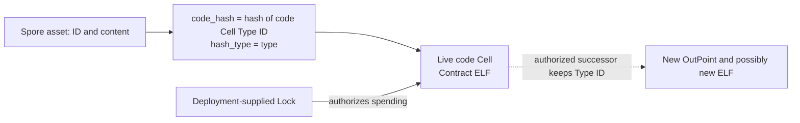

# Type-bound Spore v3 deployments

This unreleased candidate references new contract code with `hash_type: type`.
The reference is the hash of the code Cell's **standard Type ID script**, not
its ELF data hash. Existing data-bound deployments and the default SDK V2
selection are unchanged. This is not an automatic migration of existing NFTs.

## Three different Cells

| Cell | Type script | Data | Lock responsibility |
| --- | --- | --- | --- |
| Contract code Cell | Standard CKB Type ID | Contract ELF | Deployment governance |
| Native Mutant rule Cell | Type-bound Mutant lifecycle contract + rule ID | Rule ELF | Rule owner, subject to lifecycle checks |
| Spore asset Cell | Type-bound Spore contract + asset ID | Existing Spore data/DNA | Asset owner |

Changing the governance Lock of a contract code Cell is different from changing
an NFT owner's Lock. No new governance contract is introduced here. Deployers
provide an existing Lock with their intended authorization, delay and recovery
policy. A Type ID ensures identity/uniqueness; it does **not** supply upgrade
authorization or prevent an authorized controller from destroying its code
Cell. Those constraints belong to the chosen governance Lock and deployment
policy. A frozen deployment needs a Lock that actually prevents spending.

An authorized code successor keeps its Type ID but changes its OutPoint and
possibly data. Every client must resolve the live successor. The unchanged
Type ID does not certify unchanged code semantics. Current lifecycle code
preserves rule ELF data, but an upgrade to that lifecycle can change future
validation. Application sessions/replay profiles that require exact semantics
must also bind the reviewed executable hashes, including the rule ELF.



## VM selection

After Meepo activation, `hash_type: type` selects VM2 and supports native
`spawn/wait`. Before activation it selects an older VM and cannot execute the
native path. Unlike `data2`, type binding does not permanently pin a VM
version: later network upgrades also need compatibility qualification.
The native ABI, transaction indices, returning execution, payment accounting,
cell formats and CoBuild responsibilities are unchanged by this binding work.

## Explicit deployment plan

Set `SPORE_DEPLOYMENT_MANIFEST` to a TOML plan with format 1, a profile label,
and five distinct 32-byte standard Type ID arguments under `[type_ids]`:
`spore`, `cluster`, `cluster_proxy`, `cluster_agent`, `mutant`.
The mutant role means the native lifecycle code in #75/combined builds; #76's
standalone intermediate tree still uses its legacy lifecycle and executor.
No standalone #76 artifact is advertised as the complete native v3 release.

Before compiling a real deployment, reserve the funding transaction's first
CellInput and each code output's index. Derive each standard Type ID using
CKB's Type ID algorithm. Keep that first input and the output indices stable
when balancing and signing. Compile the contracts against those identities,
then publish the code Cells with those exact Type IDs and chosen governance
Locks. Verify the final transaction, live Cells, code hashes and Lock scripts
against the reviewed plan before recording any public preset. Rebuilding code
must not silently allocate a new identity.

Build-time cross-contract allowlists separate type hashes from historical
frozen data hashes, and check both the hash and its interpretation. Governance
can update code under an allowed identity; adding an entirely different code
Type ID still requires a reviewed allowlist change. Existing historical
whitelists are retained, not broadened to every old Collection.

`deployment/type-ids.fixture.toml` is **test-only**. Its IDs are not public
mainnet/testnet records. Builds require an explicit plan; CI explicitly selects
this fixture. `build/<profile>/code-type-ids.json` records the selected plan for
the VM harness. Cross forwards the same environment variable into its build.

For a local native/combined VM build:

```sh
export SPORE_DEPLOYMENT_MANIFEST=deployment/type-ids.fixture.toml
SPORE_BUILD_RUNNER=cargo \
CC_riscv64imac_unknown_none_elf="$PWD/scripts/clang-riscv.sh" \
./scripts/build-contracts.sh
cargo test --locked --manifest-path tests/Cargo.toml
```

Use `--release` and then `--release --features release_export` with the matching
`CAPSULE_TEST_ENV=release` to qualify each configuration. For actual deployment,
use the real reviewed plan rather than the fixture. This change deploys no
contracts and establishes no public governance policy.

The earlier data2 SDK captures and benchmark hashes document their original
revisions. They do not validate these type-bound artifacts; new exact-byte
SDK/devnet acceptance and deployment governance checks remain release gates.

## Local type-binding validation (2026-11-13)

| Tree | Debug | Testnet release | Mainnet release |
| --- | --- | --- | --- |
| #75 native execution | 72 passed / 2 ignored | 72 passed / 2 ignored | 72 passed / 2 ignored |
| #76 optional core intent | 57 passed / 1 ignored | 57 passed / 1 ignored | 57 passed / 1 ignored |
| Combined candidate | 78 passed / 3 ignored | 78 passed / 3 ignored | 78 passed / 3 ignored |

All listed runs had zero failures. Each tree also passed three deployment-plan
unit tests; native trees passed the invocation ABI unit test. The two added VM
cases verify code resolution under the same Type ID after a changed ELF and
OutPoint, and rejection of identical bytes under a different Type ID. These
fixtures do not simulate or approve a particular governance Lock.

Ignored cases are the historical deployment-transaction generator, the native
performance report (native trees), and the old exact-byte SDK capture (combined
tree). The old capture is explicitly pinned to its data2 artifacts; it has not
been relabelled as type-bound acceptance. Local builds used direct Cargo with
a RISC-V Clang adapter, Rust 1.92.0 for native trees and 1.74.0 for standalone
#76. Docker/Cross, live deployment and fresh CCC signed devnet/replay acceptance
were not run for these artifacts.
